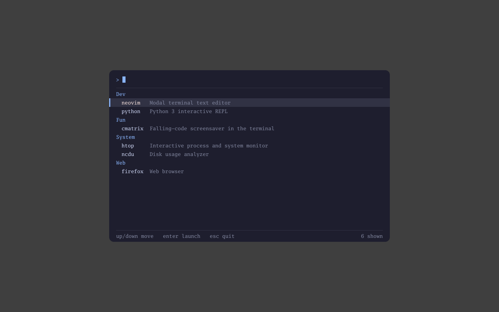

# Zinc

> Stable, Secure then beautiful

Run Linux apps in rootless Podman containers or QEMU VMs, with shared YAML
definitions, authoring tools, and terminal/Wayland launchers.

[Quickstart](docs/quickstart.md) | [Schema](common/domain/schema/schema.go) |
[Examples](common/examples/README.md) |
[Architecture](docs/architecture.md) | [Changelog](CHANGELOG.md)

## Tools

| Command | Purpose |
| --- | --- |
| `zc` | Create and edit app definitions (CLI + TUI) |
| `zcr` | Run containers |
| `zvr` | Run VMs |
| `zlt` | Terminal app picker |
| `zlg` | Wayland app picker |

## Write an app definition

**[Full schema: fields, types, and comments](common/domain/schema/schema.go)**

YAML keys match the file's `yaml:"..."` tags. Save definitions under
`$XDG_CONFIG_HOME/zinc/apps/` (default `~/.config/zinc/apps/`) and validate with
`zc validate APP --resolved`.

**Offline shell - [`zinc-hello.yaml`](common/examples/apps/zinc-hello.yaml):**

```yaml
SchemaVersion: 4
Type: ZincContainer
AppNameID: zinc-hello
ImageMeta:
  Image: docker.io/library/alpine@sha256:4bcff63911fcb4448bd4fdacec207030997caf25e9bea4045fa6c8c44de311d1
StartConditions:
  Entrypoint: /bin/sh
  Terminal: true
DisplayMeta:
  DisableGpuAccess: true
```

**Inherit the shell, add an environment variable and limits - `dev-shell.yaml`:**

```yaml
SchemaVersion: 4
AppNameID: dev-shell
Inherits: zinc-hello
StartConditions:
  EntrypointEnv: {MODE: development}
ResourcesMeta:
  MaxCPUCores: 2
  MaxRamMiB: 512
```

More samples: [attached sessions](common/examples/apps/attached-shell.yaml),
[network rules](common/examples/apps/network-client.yaml), and
[VM definitions](common/examples/apps/guest.yaml).

## Get started

The **[quickstart](docs/quickstart.md)** installs Zinc, configures PATH, and shows
`zinc-hello.yaml`. Review the file, then answer `Run this example? [y/N]`.
Networking requires [provisioning](docs/network-provisioning.md); PipeWire audio
requires the [Zinc WirePlumber policy](integration/wireplumber/README.md).

## Documentation

- [Schema and behavior](docs/architecture.md) | [VM support](docs/virtualization.md)
- [Builds, Nix, and checks](docs/build-and-checks.md) | [Contributing](CONTRIBUTING.md)
- [Release plan](RELEASES.md) | [Roadmap](ROADMAP.md)

<details>
<summary>Launcher preview</summary>



</details>
